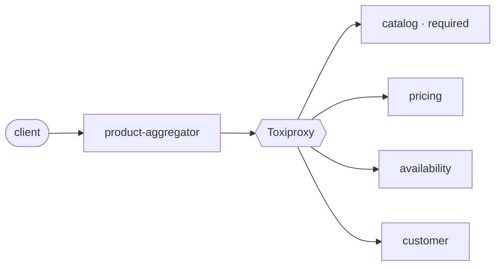

# Shopper · Product Information Aggregator

One REST call returns a product view for a market, combining Catalog, Pricing,
Availability and Customer. Java 25, Spring Boot 4.1.

This is a monorepo, so the whole system builds and runs with one `docker compose`. The
main service, which provides the solution for this task, is `product-aggregator`.
Catalog, Availability and Customer are mocks with fixed responses; Pricing is extended a
little to show a few domain design concepts and patterns (the valuation archetype,
domain-driven design).

Decisions follow the assignment's requirements and a limited time of 3–4 hours: the
aim is to show the concepts, not to cover every case. Each decision is recorded in
[`docs/adr/`](docs/adr/); planning notes are in [`docs/`](docs/).

## Run

Prerequisites: JDK 25 for `./gradlew` (the build does not download a JDK), and Docker
with Compose v2. The first `docker compose up` builds five images and takes a few
minutes.

```bash
docker compose up                             # services + Toxiproxy (realistic latency and failures)
docker compose --profile observability up     # + Prometheus, Loki, Grafana on localhost:3000
```

- `GET http://localhost:8080/products/P-1001?market=pl-PL&customerId=C-42`
- Swagger UI: http://localhost:8080/swagger-ui.html (Pricing: http://localhost:8082/swagger-ui.html)
- Tests: `./gradlew test`

The first requests after start-up can be slow while the JVMs warm up.

## Design



- **Scatter-Gather:** the four upstreams are called in parallel within one 500 ms budget
  per request ([ADR 0009](docs/adr/0009-synchronous-rest-with-parallel-fan-out-on-the-read-path.md)).
- **Catalog is required, the rest is optional:** a failing optional upstream turns its
  section into a status (`UNAVAILABLE`, `UNKNOWN`, `STANDARD`) and the response stays
  `200`; only Catalog leads to `404` or `503`.
- **Resilience values are derived, not guessed:** a per-upstream timeout set so that
  99.9% of its normal responses arrive in time, one retry of fast errors, a circuit
  breaker per upstream
  ([ADR 0016](docs/adr/0016-resilience-parameters-derived-from-upstream-latency-and-reliability.md)).
- **Ports and adapters:** a gRPC endpoint is a new inbound adapter; a new data source is
  a port, an adapter, one line in `ProductViewService` and a new optional response
  section, and it gets timeouts, retry and degradation from the existing path
  ([ADR 0008](docs/adr/0008-ports-and-adapters-in-the-aggregator.md),
  [ADR 0017](docs/adr/0017-typed-ports-with-one-shared-fetch-path-for-upstream-sources.md)).
- **Pricing** is a small implementation of the valuation archetype: list price,
  discounts, promotions and VAT are versioned components, not code
  ([ADR 0013](docs/adr/0013-pricecomponent-as-the-aggregate-in-pricing.md)).
  Catalog, Availability and Customer are mocks.
- **Observability:** a trace id in every response and log line, metrics and a Grafana
  dashboard ([ADR 0018](docs/adr/0018-observability-structured-logs-metrics-health-and-trace-context.md)).

## Trade-offs

- Synchronous reads instead of events and projections: fresh data, at the cost of
  depending on upstream availability (ADR 0009, 0010).

## With more time

- Move towards an asynchronous read model with a message broker, e.g. Kafka: upstreams
  publish integration events and the aggregator keeps its own projection, so a read is
  one local query instead of a fan-out, and a catalog outage no longer fails requests.
  The cost is eventual consistency, so I would start with slow-changing data (catalog,
  customer profile) and keep price and stock live, as they change too often for a
  lagging projection (ADR 0009, 0010).
- A security layer with Spring Security: the aggregator as an OAuth2 resource server
  validating JWTs, the customer id taken from the token instead of a query parameter (so
  a client cannot request another customer's view), scopes per endpoint, actuator
  endpoints other than health closed to the public, and a token for the aggregator's own
  calls to the upstreams (OAuth2 client credentials), so every service validates JWTs
  the same way.
- A k6 load test against the expected peak; Tempo for traces.
- Tidy up the documentation (fewer planning pages, the decisions kept in the ADRs) and
  the availability and latency calculations behind the resilience parameters.
- Wider test coverage: the tests now cover the behaviour spec; every requirement would
  get its own tests.
- Richer mocks that return varied data: more products, markets, customers and stock
  levels, instead of a few fixed responses.
- More time for refactoring the code.

## Design question A: Related Products (200 ms, 90% reliability)

Optional: the product page is useful without it. Adding it means a port, an adapter with
its own timeout and circuit breaker, and one more parallel call in `ProductViewService`
(ADR 0017); how calls are made and how failures degrade stays as it is. The trade-off is
a change to the aggregator's response contract, but an additive one: a new optional
section that existing clients ignore. Another trade-off: its latency and reliability are
far from the current upstreams', so the timeout, retry and circuit breaker values
(ADR 0016) would have to be recalculated for it and possibly adapted.

Harder cases, such as several interchangeable providers that come and go, would need
more than a new adapter. For those, patterns from Enterprise Integration Patterns could
be used: a Dynamic Router, where providers register themselves, or Scatter-Gather as an
auction, where the request goes to every provider over publish-subscribe and an
aggregator picks the best reply.

## Chaos test

[`.ai/skills/chaos-test`](.ai/skills/chaos-test/SKILL.md) takes the upstreams through
slow, hanging, resetting and stopped states and reports what the client sees, while the
Grafana dashboard shows it live.
