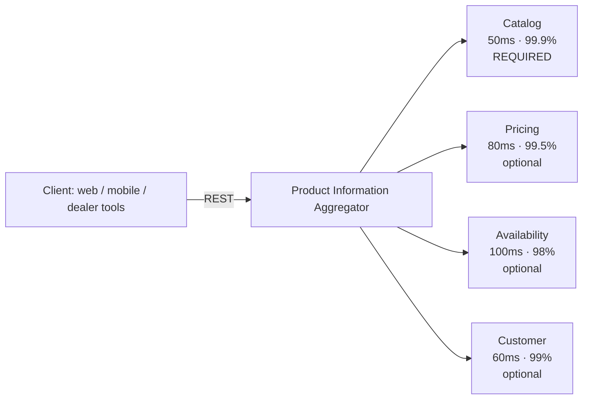

# Assignment: Product Information Aggregator (Kramp)

Source: [kramp-backend-assignment.pdf](#/kramp-backend-assignment.pdf) (local only, not in the repository)

A B2B platform for agricultural and machinery parts, serving 20+ markets and languages across Europe. Today the frontend makes several separate calls to render one product view, which leads to slow pages, inconsistent behaviour when a service fails, and logic duplicated across clients.

**Goal:** one backend service that aggregates product data for a given customer context.

- **Input:** `productId` + market/language (`nl-NL`, `de-DE`, `pl-PL`…) + optional `customerId`
- **Output:** aggregated product information, ready for display and appropriate for the market

## Upstreams (to be mocked)

| Service | Returns | Latency | Reliability | When it fails |
|---|---|---|---|---|
| Catalog | name, description, specs, images | 50ms | 99.9% | **the whole request fails** |
| Pricing | base price, customer discount, final price | 80ms | 99.5% | product + "price unavailable" |
| Availability | stock level, warehouse, expected delivery | 100ms | 98% | product + "stock unknown" |
| Customer | segment, preferences (only with a `customerId`) | 60ms | 99% | non-personalised response |

> The mocks have to behave realistically: artificial delays and occasional failures matching the reliability figures. The assignment says outright that the mocks are how they will judge our understanding of distributed systems.

## Requirements

**Functional**
- accepts a `productId`, a market code and an optional `customerId`;
- returns aggregated data, handling missing and unavailable data gracefully;
- the response is appropriate for the requested market and language.

**Non-functional**
- reasonable response time even when upstreams are slow;
- the failure of one upstream does not break the whole response;
- a new data source can be added without major refactoring.

**Constraints**
- REST is required, gRPC is a bonus;
- Java 17+, Kotlin or Go.

## What they evaluate

1. Approach: how the aggregation is structured, partial failures, required vs optional data.
2. Technical decisions: patterns, libraries, trade-offs.
3. Production readiness: failure handling, operating the service.
4. Code quality: clear, testable, maintainable.

## Deliverables

- working code on GitHub that runs locally with minimal setup;
- a README covering:
  - how to run it;
  - design decisions and trade-offs;
  - what we would do differently with more time;
  - the answer to one design question;
- a 45-minute follow-up discussion of the solution.

**Budget: 3–4 hours.** They prefer a focused, well-reasoned solution over a complete one.

## Design question (pick one)

- **A:** a Related Products service (200ms, 90% reliability): how would it fit in, and should it be required?
- **B:** flash sales, with prices changing every few minutes: how does that affect the design?
- **C:** 5 new markets: what would have to change?

## Interview scenarios

- "A customer in Poland requests a product. Walk me through exactly what happens."
- "The Pricing Service starts timing out. What does the customer see?"
