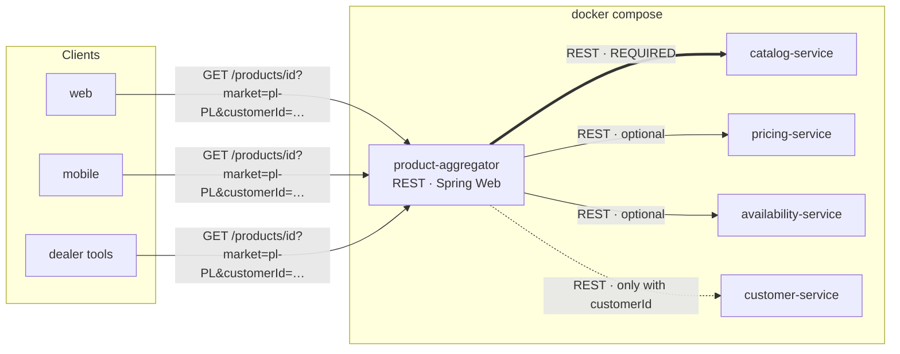
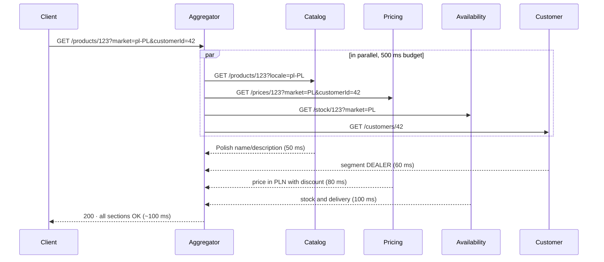
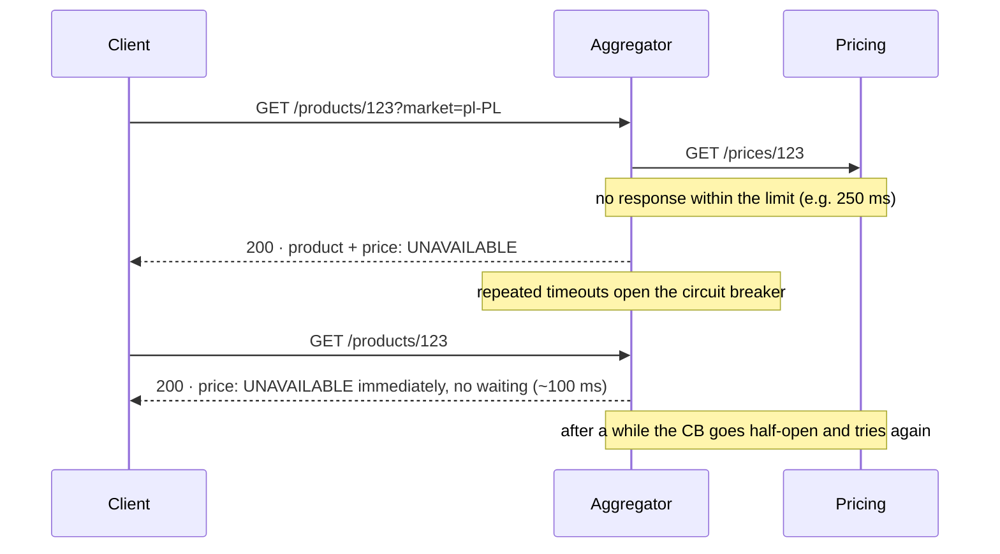
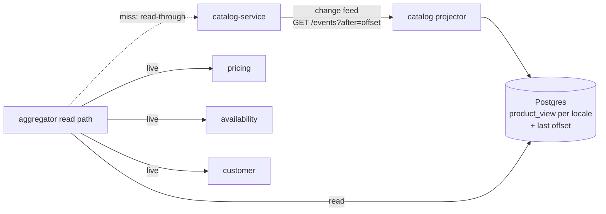

# 01 · Big picture: first planning pass

> Status: **draft for discussion**. Settled points go into the [ADRs](#/adr/0000-java-and-spring-boot-as-the-technology-stack.md); open ones are at the bottom of the page.

## 1. Settled

| Decision | ADR |
|---|---|
| Java + Spring Boot | [0000](#/adr/0000-java-and-spring-boot-as-the-technology-stack.md) |
| REST only, no gRPC | [0001](#/adr/0001-rest-only-no-grpc.md) |
| Each upstream is a separate service in Docker | [0002](#/adr/0002-upstreams-as-separate-services-in-docker.md) |
| Pricing is a real archetype, the rest are mocks ([design](#/02-pricing.md)) | [0003](#/adr/0003-pricing-as-a-real-archetype-implementation-other-upstreams-as-mocks.md) |
| Pricing keeps its state in memory | [0004](#/adr/0004-in-memory-storage-for-pricing.md) |
| Java 25 + Spring Boot 4.1 | [0005](#/adr/0005-java-25-and-spring-boot-4-1.md) |
| Monorepo with a module per service | [0006](#/adr/0006-monorepo-for-all-services.md) |
| Gradle | [0007](#/adr/0007-gradle-as-the-build-tool.md) |
| Ports and adapters in the aggregator | [0008](#/adr/0008-ports-and-adapters-in-the-aggregator.md) |
| Synchronous REST with parallel fan-out on the read path | [0009](#/adr/0009-synchronous-rest-with-parallel-fan-out-on-the-read-path.md) |
| Catalog projection fed by a change feed (CQRS light, provisional) | [0010](#/adr/0010-catalog-projection-in-the-aggregator-fed-by-a-change-feed.md) |
| Context map: ACLs in the aggregator, Pricing as OHS | [0011](#/adr/0011-context-map-upstreams-behind-anti-corruption-layers-pricing-as-open-host-service.md) |
| Aggregator as an integration context, no DDD aggregates | [0012](#/adr/0012-aggregator-as-an-integration-context-without-ddd-aggregates.md) |
| `PriceComponent` as the aggregate in Pricing | [0013](#/adr/0013-pricecomponent-as-the-aggregate-in-pricing.md) |

## 2. System map

| Service | Responsibility | Archetype candidate | When it fails |
|---|---|---|---|
| **product-aggregator** | composes the response, enforces the time budget, degrades sections | — (the core of the assignment) | — |
| catalog-service | product data localised for the market/language | **Product** | the whole request fails |
| pricing-service | base price, customer discount, final price in the market's currency | **Pricing** | `price: UNAVAILABLE` |
| availability-service | stock per warehouse, delivery estimate | **Inventory** | `stock: UNKNOWN` |
| customer-service | segment, preferences | **Party** | non-personalised response |

## 3. Communication: synchronous or asynchronous?

**Recommendation: the read path is synchronous (REST); asynchrony is a README topic only.**

| | Synchronous (REST) | Asynchronous (events, Kafka/Rabbit) |
|---|---|---|
| Fits | the "show me the product now" query | propagating changes (price, stock) into a local copy |
| Data freshness | always current | eventual consistency |
| Dependence on upstream availability | full, hence the patterns in §4 | none: we read our own read model |
| Cost within 3–4 h | small | large: broker, consumers, read model |
| Where it lives here | **implemented** | described in the README |

The aggregator follows the **API Composition / Scatter-Gather** pattern; in practice it is a Backend-for-Frontend shared by all clients. Calls go out **in parallel**, so the response time is roughly the slowest upstream (~100 ms), not the sum (~290 ms).

The asynchronous alternative is **CQRS / a materialized view**: upstreams publish events and the aggregator keeps a ready-made product view. Reads become fast and failure-resistant, but prices and stock go stale and a broker joins the system. Good material for the interview and the README, not for implementation.

## 4. Protection: patterns

| Pattern | Protects against | How we apply it | Tool |
|---|---|---|---|
| **Per-upstream timeout** | a slow upstream holding up the response | a separate timeout per service, derived from its latency | `RestClient` / HTTP client |
| **Whole-request budget (deadline)** | timeouts and retries adding up | e.g. 500 ms in total; whatever misses it is degraded | `CompletableFuture.orTimeout` |
| **Parallel fan-out** | latencies adding up | all calls at once | virtual threads + `CompletableFuture` |
| **Fallback / graceful degradation** | an optional upstream failing | a section with status `UNAVAILABLE` instead of an error | our own response model |
| **Circuit breaker** | hammering a dead service and waiting for the timeout on every request | an open CB means an immediate fallback | Resilience4j |
| **Retry (carefully)** | transient errors | GET only, at most 1 retry with jitter, **only if it fits the budget** | Resilience4j |
| **Bulkhead** | a slow upstream consuming every thread/connection | a cap on concurrent calls per upstream | Resilience4j |
| **Cache (stale-on-error)** | catalog failures and load | the catalog changes rarely: short TTL, serve the stale copy on failure (optional) | Caffeine |
| **Correlation ID** | debugging a distributed request | a header propagated to upstreams and into logs | MDC + interceptor |
| **Metrics and health** | operating the service | latency, errors and CB state per upstream | Actuator + Micrometer |

Numbers for the interview: Availability is 98% reliable, so **one** retry raises that to ~99.96% (if failures are independent). A retry only makes sense when it fits the budget, though; otherwise it just turns an error into a timeout.

**Required or optional?** Each upstream is described by a policy: *required*, *optional* or *conditional* (Customer only with a `customerId`). The aggregator has no `if`s for specific services. Adding a new source (e.g. Related Products from question A) means a new adapter and a policy, with no changes to the core.

**Catalog: two distinct cases**
- the product does not exist → `404`;
- the catalog does not respond → `503`/`502`.

These are different situations and the client should be able to tell them apart.

## 5. Interview scenarios

### "A customer in Poland requests a product"

### "The Pricing Service starts timing out"

The customer **always sees the product**, with the price marked as unavailable. With the CB open the response is even faster than normal, because nobody waits for a timeout.

## 6. Mocks: where they judge our understanding of distributed systems

- **Latency as a distribution, not a constant.** The median equals the assignment's "typical latency", with a long tail: p99 several times higher.
- **Different kinds of failure:**
  - fast 5xx;
  - hangs (timeout);
  - slow responses;
  - selected cases: bad data / 404.
- **Failure rates** matching the reliability table (Catalog 0.1%, Pricing 0.5%, Availability 2%, Customer 1%).
- **Chaos control**, e.g. `POST /chaos` or environment variables: "Pricing has 100% timeouts". It lets us show the scenarios live and write deterministic tests.

## 7. Scope (settled)

- **Aggregator**: a proper architecture (ports and adapters), required/optional policies, resilience, tests.
- **Pricing**: a real implementation of the archetype, described in [02 · Pricing](#/02-pricing.md).
- **Catalog, Availability, Customer**: mocks with a fake API and the realistic network behaviour from §6.
- Pricing gets the same latency and failure simulation as the mocks.

## 7a. Where state lives (Postgres, projections, read models)

| Component | State | Where |
|---|---|---|
| Aggregator | projections in **Postgres** (proposal, variant to choose below) | Postgres |
| Pricing | components, versions, price lists, contracts | in memory ([ADR 0004](#/adr/0004-in-memory-storage-for-pricing.md)) |
| Mocks | test data | in memory |

**Postgres in the aggregator: what kind of projection?** The term covers two very different designs:

| | (a) Event-driven read model (full CQRS) | (b) Last-known-good snapshot | (c) No Postgres |
|---|---|---|---|
| How it gets filled | upstreams publish events to a broker; the aggregator consumes them | the aggregator saves every successful upstream response | — (in-memory cache only) |
| Read path | reads only its own Postgres, no upstream calls | calls upstreams live; reads the snapshot **only when an upstream fails** | calls upstreams live |
| Upstream failure | invisible to the client | the client gets the last known data, marked `stale` with an "as of" time | section `UNAVAILABLE` |
| Freshness | event lag (seconds) | live; stale only during a failure | live |
| Extra pieces | broker (Kafka/Rabbit), publishers in every upstream, consumers, idempotency, replay | Postgres, Flyway, one table per source | none |
| Cost within 3–4 h | **too large**: it alone fills the budget | medium (~45 min) | none |
| Fit with fast-changing prices | risky: a lagging price is a wrong price | per source: stale stock is acceptable, a stale price is not | fine |

Why not full CQRS (a) for everything:
- **It sidesteps what they evaluate.** If every read hits our own Postgres, the upstreams' latency and reliability never reach the read path, so timeouts, partial failures and degradation stop mattering.
- **Price and stock change fast** (flash sales, live stock). A projection lagging by seconds shows wrong prices.
- **Cost.** A broker, publishers in four services, consumers, idempotency and replay fill the budget by themselves.

### (d) CQRS light: project only the catalog

Split the sources by how fast they change:

| Source | Changes | How the aggregator reads it |
|---|---|---|
| Catalog | rarely (name, specs, images) | **projection in Postgres**, fed by catalog change events |
| Pricing, Availability, Customer | constantly / per request | **live**, with the resilience patterns from §4 |

- **Transport without a broker:** the catalog exposes an ordered change feed (`GET /events?after=<offset>`); the aggregator polls it, upserts the projection and stores the last offset in the same transaction. That gives idempotency and replay with no Kafka/Rabbit. A broker is the README's "production" answer.
- **Projection miss** (a new product not projected yet): read-through to the live catalog, so lag never turns into a false 404.
- **What it buys:** the only *required* upstream drops off the hot path. A catalog outage no longer fails requests for products already projected.
- **What it costs:** ~1–1.5 h (Postgres, Flyway, projector, feed endpoint in the catalog mock), and a deliberate reinterpretation of the constraint "if Catalog fails, the request fails". It still holds for products we have never seen; it has to be argued in the interview, not hidden.

Recommendation: **(d) instead of (b)**, not both. It shows CQRS where it fits (slow-changing, required data) and live aggregation where it fits (fast-changing, optional data), which is the more interesting trade-off to defend. If the budget gets tight, (b) is the fallback.

## 8. Open questions

1. **Customer segment for discounts:** from the contract in Pricing, or passed in by the aggregator? (details in [02](#/02-pricing.md))
2. **Language and market:** a language fallback (e.g. missing `pl` translation → `en`)? Currency derived from the market (`pl-PL` → PLN)?
3. The message cut off at "główna fun…". What was meant to follow?

Resolved: ~~depth of DDD and archetypes in the mocks~~ → ADR 0003 · ~~versions~~ → ADR 0005 · ~~repository layout~~ → ADR 0006, 0007 · ~~Postgres variant~~ → ADR 0010.
