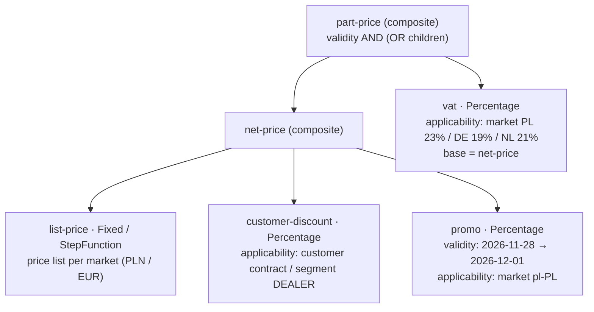

# 02 · Pricing: the valuation archetype

> Status: **draft for discussion**. Decision: [ADR 0003](#/adr/0003-pricing-as-a-real-archetype-implementation-other-upstreams-as-mocks.md).

## Why an archetype, not a `price` column

A good test question: *"why did this customer get this price?"* If answering it requires reading code, there is no price model.

Per the assignment, Pricing returns the **base price, customer discount and final price**. Those three numbers are simply the **breakdown** of a computed price, not three columns in a table.

## Five layers (what we will use)

| Layer | Question | Here | Build it? |
|---|---|---|---|
| **Calculator** | **how** we compute (pure maths) | `Fixed` (price-list price), `Percentage` (discount, VAT), `StepFunction` (B2B quantity breaks) | ✅ 2–3 calculators |
| **Ranges** | **which** function for which parameter | quantity breaks: 1–9 pcs, 10–49, 50+ | ⚠️ only if time allows |
| **Interpretation** | what the number **means** (total / unit / marginal) | unit price and line price | ⚠️ minimal: UNIT/TOTAL |
| **Component** | what it **is** in business terms + the tree | `list-price`, `customer-discount`, `promo`, `vat` | ✅ the heart of the demo |
| **Validity** | **when** it applies (versions) | a promotion from–to, a new price list from 1 January | ✅ |
| **Applicability** | **whether, and for whom** | market, customer segment, a specific contract | ✅ |

The rule: **a calculator knows nothing about the business**. `Percentage` is just a percentage; it becomes VAT or a discount only through the component that contains it.

## Model of a part's price (example)



The same through the API, as a breakdown:

```json
{
  "productId": "123", "market": "pl-PL", "currency": "PLN",
  "basePrice": 412.00,
  "customerDiscount": -41.20,
  "finalPrice": 370.80,
  "breakdown": [
    { "component": "list-price",        "amount": 412.00, "formula": "f() = 412.00" },
    { "component": "customer-discount", "amount": -41.20, "formula": "f(base) = base × -10%", "reason": "contract DEALER-PL-0042" }
  ],
  "priceValidAt": "2026-10-20T10:00:00Z"
}
```

## What we will show in the interview (flexibility)

| Scenario | Without the archetype | With the archetype |
|---|---|---|
| **Flash sale** (question B) | `if (promo)`, a deploy, a cache to invalidate | a new **version** of the `promo` component with a 2-hour `validity`; time picks the version, and after the promotion *"we do nothing"* |
| **New market** (question C) | new columns and `if (market == …)` | data: a price list in the new currency + a VAT component with new `applicability` |
| **Dealer-only discount** | a flag in the code | `applicability: segment = DEALER` |
| **B2B volume discount** | a breaks table in the order service | a `StepFunction` in `list-price` |
| **"Why this price?"** | reading the code | a breakdown with formulas in the response |
| **A past price** | logs | versions with `validity`, so history follows from the model |

Conclusion for the design question: **B (flash sales) and C (new markets) both showcase this archetype directly.** I recommend **B**: it also touches the aggregator, because caching prices becomes a problem when they change every few minutes.

## Where does Pricing get customer data from?

The customer discount is **Pricing's data**: a discount contract keyed by `customerId`. Pricing **does not call** the Customer Service. As a result:
- the aggregator can call Pricing and Customer **in parallel**;
- Pricing stays an upstream with no dependencies on other services, in line with the archetype: *"pricing provides a capability, not a process"*.

To decide: do we also keep the segment (`DEALER`/`WORKSHOP`) in Pricing, as part of the contract, or does the aggregator pass it in the request? I recommend **the contract in Pricing**. Otherwise the calls become sequential (Customer first, then Pricing) and latency grows.

## Persistence

Pricing is the only service with real state: components, their versions with `validity`, price lists and contracts. That makes it the natural home for **Postgres**:
- component and version definitions as tables, calculator parameters as `jsonb`;
- seed data through Flyway;
- versions are immutable (append-only), which makes auditing easy.

Alternative: in memory, seeded from a file. Faster, but "history follows from the model" only lasts until the next restart.

## Scope for 3–4 h: build it evolutionarily

We build:
- **calculators:** Fixed, Percentage, possibly StepFunction;
- **components:** Simple and Composite;
- **Validity** and **Applicability** (market, segment, contract);
- the **breakdown** in the response;
- **an endpoint for adding a component version**: lets us run a flash sale live.

We skip:
- interpretation adapters;
- DiscretePoints;
- nested time ranges;
- what-if simulation;
- a UI.

All of these go into the README as "next steps".
