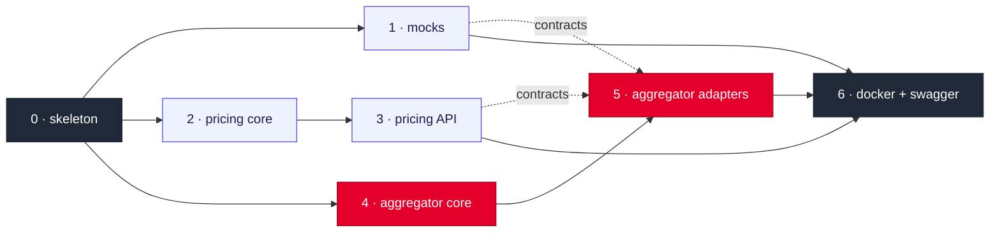

# 03 · Implementation plan

> Status: **implemented**. All seven stages are on `main`, one or two commits each, as listed below; 40 tests green and the stack checked end to end in Docker. Details per stage: [08 · Code plan](08-code-plan.md).

## Stages and commits

🔴 = commit with the tests only (red: it does not compile yet, on purpose, so the history shows tests first). 🟢 = commit with the implementation (green).

| Stage | Commits | Adds | Tests | Depends on |
|---|---|---|---|---|
| **0** | `build: add Gradle multi-module skeleton for five services` | Gradle, five modules, Actuator and tracing in each, `application.yml` | 5 (contexts load) | — |
| **1** | 🔴 `test(mocks): specify mock upstream behaviour` 🟢 `feat(mocks): implement catalog, availability and customer mocks` | three mocks with the shared sample data | 7 | 0 |
| **2** | 🔴 `test(pricing): specify pricing behaviour P1–P4` 🟢 `feat(pricing): implement the pricing model, service and in-memory storage` | the archetype: calculators, components, versions, tariff, breakdown | 3 | 0 |
| **3** | 🔴 `test(pricing): specify the pricing HTTP API` 🟢 `feat(pricing): expose prices and component versions over REST` | `GET /prices` with `at`, `POST …/versions` | 2 | 2 |
| **4** | 🔴 `test(aggregator): specify product view composition A1, A3–A10` 🟢 `feat(aggregator): compose the product view with parallel calls within the request budget` | domain, ports, `ProductViewService` (Scatter-Gather, 500 ms budget) | 9 | 0 |
| **5** | 🔴 `test(aggregator): specify the aggregator over HTTP A1, A2, A5–A7, A10–A13` 🟢 `feat(aggregator): add REST adapters with timeouts, retry and circuit breakers, the product endpoint and observability` | `UpstreamClient`, adapters with `@Retryable`, controller, error mapping, logs, metrics, `X-Trace-Id` | 14 | 4 (contracts from 1 and 3) |
| **6** | `build(docker): run the whole system with docker compose and expose Swagger UI` | Dockerfile, compose, JSON logs, Swagger UI on every service | by hand | 1, 3, 5 |

**Total:** 90 files, ~2550 lines, 40 tests.

**Order:** stages 1, 2 and 4 are independent and can run in parallel; then 3 and 5; 6 last.

## After the implementation

| What | When |
|---|---|
| README: how to run, decisions and trade-offs, "with more time", the design question | after stage 6 |
| Toxiproxy with the assignment's latency and failure figures, always on (ADR 0014) | ✅ done |
| Prometheus, Loki and Grafana with one dashboard, `docker compose --profile observability up` (ADR 0018) | ✅ done |
| Chaos-testing skill in `.claude/skills/` | last |

Before showing the demo, send a few warm-up requests: the first calls after a cold start can exceed the steady-state timeouts (ADR 0018).

## How it gets built

1. Review the code plan and discuss changes.
2. After acceptance, the stages are cut into tasks in **beads**, with the dependencies above, and shown for confirmation before they are created.
3. **Workers** in tmux panels take the tasks. The coordinator verifies every report (build, tests, and the code against the accepted plan) before closing a task.
