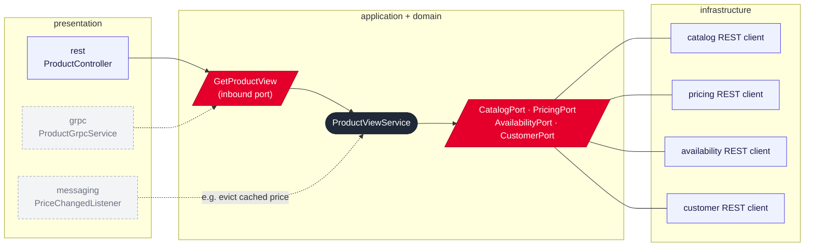
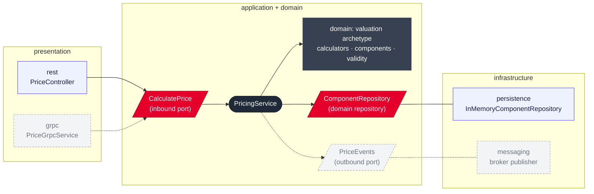
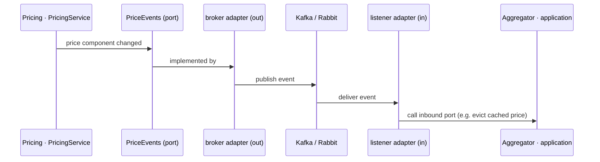

# 04 · Module architecture: aggregator and pricing

> Status: **agreed** (ADR 0008, ADR 0015). Communication is synchronous REST today (ADR 0009); the broker is an option for later. Both services use ports and adapters. Dashed boxes are not built: they show where gRPC and a message broker would plug in.

## The rule

- **Domain + application** in the middle: no Spring Web, no HTTP, no broker.
- **Presentation** (inbound adapters: REST today, gRPC tomorrow, published integration events) calls an **inbound port**, a use-case interface.
- **Infrastructure** (outbound adapters: REST clients, persistence, broker) implements **outbound ports** declared by the application, and **repositories** declared by the domain.
- Outbound ports are for other systems; a repository is for the service's own aggregates.
- A new protocol or transport = a new adapter. The middle does not change.

## Aggregator

Package structure: [06 · Packages and flow](06-packages-and-flow.md).

## Pricing

Package structure: [06 · Packages and flow](06-packages-and-flow.md).

## Future broker: who talks to whom

Services never talk to the broker from the core: **adapters talk to adapters**, ports keep the core unaware of the transport.

## What we build vs what we only show

| | Built | Shown as a slot (diagram + README) |
|---|---|---|
| Inbound | REST controllers | gRPC services, broker listeners |
| Outbound | REST clients, in-memory repository | broker publisher |

Future slots are not created in code (no empty packages, no unused interfaces); they live in this diagram and the README.
