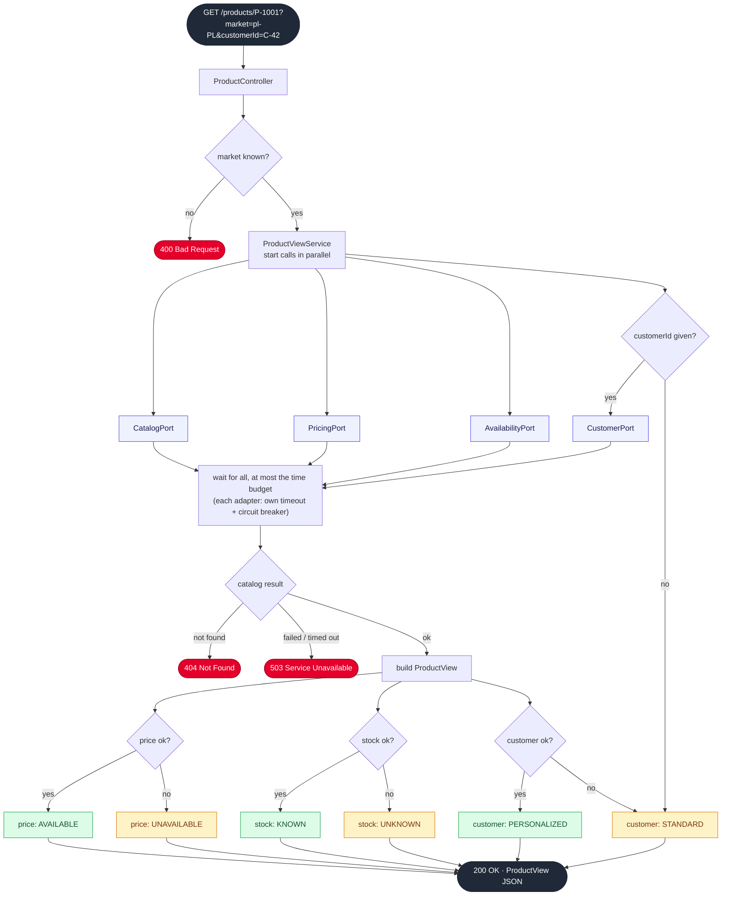

# 06 · Packages and flow

> Status: **agreed**. Layers: `domain` · `application` · `infrastructure` (outbound adapters, config) · `presentation` (inbound adapters). Main classes only; tests mirror the [behaviour spec](05-behaviour-spec.md). Each service has its own `Market` and `Money`: no shared kernel between services. Packages for future transports (`grpc`, `kafka`, `listener`, `integrationevent`) are not created until needed.

## Aggregator

```
product-aggregator/src/main/java/com/shopper/aggregator/
├── AggregatorApplication
├── domain/
│   ├── Market                    pl-PL / de-DE / nl-NL; parsing an unknown market fails
│   ├── ProductDetails            name, description, specs, images
│   ├── Price                     currency, base, discount, final
│   ├── Stock                     quantity, warehouse, expected delivery
│   ├── CustomerProfile           segment, preferences
│   ├── ProductView               product + Optional price, stock and customer
│   ├── ProductNotFoundException  → 404
│   └── CatalogUnavailableException → 503
├── application/
│   ├── port/in/   GetProductView
│   ├── port/out/  CatalogPort, PricingPort, AvailabilityPort, CustomerPort
│   └── service/   ProductViewService     parallel calls, time budget, builds ProductView
├── infrastructure/
│   ├── adapter/
│   │   ├── catalog/      CatalogRestClient       (+ upstream DTO)
│   │   ├── pricing/      PricingRestClient
│   │   ├── availability/ AvailabilityRestClient
│   │   └── customer/     CustomerRestClient
│   └── config/
│       ├── UpstreamClientsConfig  base URLs and timeout per upstream
│       └── ResilienceConfig       circuit breaker per upstream
└── presentation/
    └── rest/
        ├── ProductController      GET /products/{id}?market&customerId
        ├── ProductResponse        JSON shape
        └── ErrorHandler           exceptions → 400 / 404 / 503

product-aggregator/src/test/java/com/shopper/aggregator/
├── application/service/ProductViewServiceTest   unit: fake ports (A1, A3–A9)
└── component/ProductEndpointComponentTest       whole app + WireMock (A1, A2, A5–A7, A10–A13)
```

Where each concern lives:

| Concern | Place |
|---|---|
| HTTP in / JSON / status codes | `presentation/rest` |
| Timeout and circuit breaker per upstream | `infrastructure/adapter/*` + `infrastructure/config` |
| Parallel calls, time budget, required vs optional | `application/service/ProductViewService` |
| How a missing part is shown to clients (`UNAVAILABLE`, `UNKNOWN`, `STANDARD`) | `presentation/rest/ProductResponse` |

## Pricing

```
pricing-service/src/main/java/com/shopper/pricing/
├── PricingApplication
├── domain/
│   ├── Market, Money             market → currency; amount + currency
│   ├── PricingContext            product, market, customer, moment in time
│   ├── calculator/
│   │   ├── Calculator            sealed: pure function, knows no business
│   │   ├── FixedCalculator       list price
│   │   └── PercentageCalculator  discount, promotion, VAT
│   ├── component/
│   │   ├── PriceComponent        aggregate: identity + versions
│   │   ├── ComponentVersion      immutable: validity + calculator + applicability
│   │   ├── Validity              [from, to)
│   │   ├── Applicability         markets, customers, products
│   │   └── ComponentRole         LIST_PRICE, DISCOUNT, TAX
│   ├── repository/
│   │   └── ComponentRepository   repository of the PriceComponent aggregate
│   ├── PriceQuote                net, VAT, gross + breakdown lines
│   └── NotPricedException        → 404
├── application/
│   ├── port/in/   CalculatePrice
│   └── service/   PricingService   picks applicable components at the moment, sums the breakdown
├── infrastructure/
│   ├── persistence/
│   │   ├── InMemoryComponentRepository
│   │   └── SeedData              shared test data: P-1001, C-42, VAT per market, flash sale
│   └── config/
└── presentation/
    └── rest/
        ├── PriceController       GET /prices/{productId}?market&customerId
        └── PriceResponse

pricing-service/src/test/java/com/shopper/pricing/
├── application/service/PricingServiceTest     examples P1–P4 (fixed clock)
└── presentation/rest/PriceControllerTest      P5 over HTTP
```

Pricing has no outbound port: it calls no other system. Its repository belongs to the domain, because it stores the domain's own aggregate.

## Aggregator request flow



Reading it in the interview:
- **"A customer in Poland requests a product"**: the path down the green boxes.
- **"Pricing starts timing out"**: `PricingPort` times out (or its circuit is open), so `price: UNAVAILABLE` (amber). The response is still `200`, and it is never slower than the time budget.
