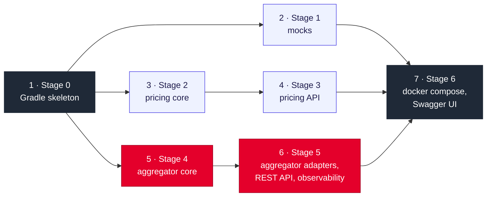

# 11 · Beads plan

> Status: **created in beads** (2026-10-21). Epic `shop-d5k`; items below. The backlog is local to this machine (`.beads/` is excluded from git).

## Parent (epic)

**Implement the shopper services from the accepted code plan**

Holds everything the items share, so each item only links to it:
- **Source of truth:** the code of every class and test in `hub/code-plan/files/<module>/…`, the stages in `hub/pages/08-code-plan.md`.
- **Path mapping from the hub to the repo:**
  - `aggregator/application/…` → `product-aggregator/src/main/java/com/shopper/aggregator/application/…` (same for the other modules);
  - `test/…` → `src/test/java/…`;
  - `resources/…` → `src/main/resources/…`;
  - files marked "(stage 0)" are intermediate versions, replaced later.
- **Commit rules:** two commits per stage, 🔴 tests only (do not compile yet, on purpose), then 🟢 implementation; messages in English exactly as in the plan; no `Co-Authored-By` trailer; no comments in code.
- **Environment:** Java 25 from SDKMAN (`source ~/.sdkman/bin/sdkman-init.sh`); Docker through `sg docker -c …`.

## Items

Arrows point from a prerequisite to the item it unblocks. Items 2, 3 and 5 can run in parallel, then 4 and 6, then 7.

| # | Bead | Title | Depends on | Done when |
|---|---|---|---|---|
| 1 | `shop-9dd` | `Stage 0: Gradle skeleton for five services` | — | Gradle 9.8.2 wrapper; `./gradlew test`: 5 green |
| 2 | `shop-ie3` | `Stage 1: catalog, availability and customer mocks` | 1 | 🔴 → 🟢; mock tests: 7 green |
| 3 | `shop-y11` | `Stage 2: pricing core (valuation archetype)` | 1 | 🔴 → 🟢; `PricingServiceTest`: 3 green |
| 4 | `shop-h1m` | `Stage 3: pricing REST API` | 3 | 🔴 → 🟢; `PricingApiTest`: 2 green |
| 5 | `shop-gh2` | `Stage 4: aggregator core` | 1 | 🔴 → 🟢; `ProductViewServiceTest`: 9 green |
| 6 | `shop-ix3` | `Stage 5: aggregator adapters, REST API and observability` | 5 | 🔴 → 🟢; `ProductEndpointComponentTest`: 14 green |
| 7 | `shop-pn5` | `Stage 6: docker compose and Swagger UI` | 2, 4, 6 | `docker compose up --build` and the checks on page 08 (200, 404, 400, Pricing and Catalog stopped, Swagger on 8080 and 8082); `./gradlew test`: 40 green |

**Would it still work if we stopped after any item?** Yes: every item ends with a 🟢 commit and a green build. The only broken state, the 🔴 commit, always sits inside one item.

**Parallel items:** each worker gets its own git worktree and branch; the coordinator merges into `main` after verifying. Items 2, 3 and 5 touch different modules. Item 7 edits the stage-0 `build.gradle.kts` (adds springdoc) but runs last.
