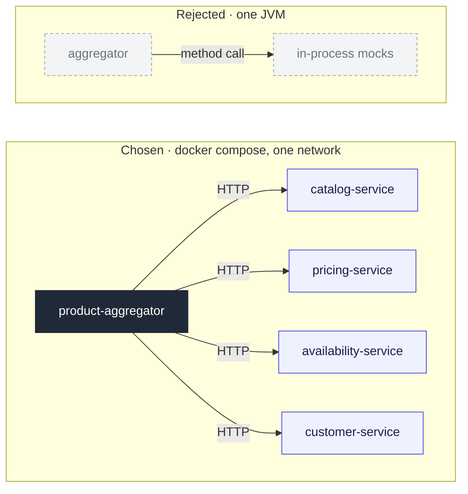

# Upstreams as separate services in Docker

## Context and Problem Statement

The aggregator combines data from four upstreams (Catalog, Pricing, Availability,
Customer) owned by other teams. They are not available for local development and
testing, so they are simulated. The simulation has to reproduce how a distributed
system behaves: network latency, timeouts and failures. We have to decide where the
simulated upstreams run.

## Decision Drivers

* The problem is distributed by nature, so the simulation should reflect that.
* Developers must be able to run the whole system locally with minimal setup.

## Considered Options

* Each upstream as a separate service, run in Docker
* Mocks as components inside the aggregator process

## Decision Outcome

Chosen option: "Each upstream as a separate service, run in Docker", because only
separate processes talking over the network simulate the distributed system the
aggregator runs in.

### Consequences

* Good, because the aggregator deals with real network calls: timeouts, dropped
  connections and 5xx responses.
* Bad, because running the whole system requires Docker. Setup has to come down to a
  single command.
