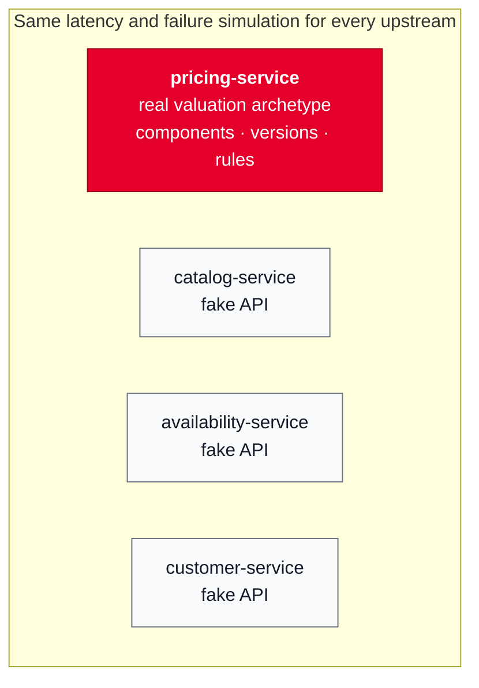

# Pricing as a real archetype implementation, other upstreams as mocks

## Context and Problem Statement

The four upstreams (Catalog, Pricing, Availability, Customer) run as separate services
(ADR 0002). We have to decide how much domain logic each of them gets.

## Decision Drivers

* Pricing is where the domain complexity lies: promotions, customer discounts and
  market-specific currency and VAT change often and have to be configurable.
* The first version has limited time; a focused solution is preferred over a complete
  one.

## Considered Options

* Every service with full DDD and its matching archetype
* Every service as a lightweight mock
* Pricing as a real archetype implementation, the others as mocks

## Decision Outcome

Chosen option: "Pricing as a real archetype implementation, the others as mocks",
because it applies the archetype where it pays off most and keeps the other services
simple.

### Consequences

* Good, because promotions, discounts and new markets are introduced through
  configuration rather than code changes.
* Bad, because Pricing is the largest single piece of work. We implement only the part
  of the archetype the current requirements need.
* Neutral, because Pricing still has to behave like a real upstream (typical latency
  80 ms, 99.5% reliability), so it gets the same latency and failure simulation as the
  other upstreams.
