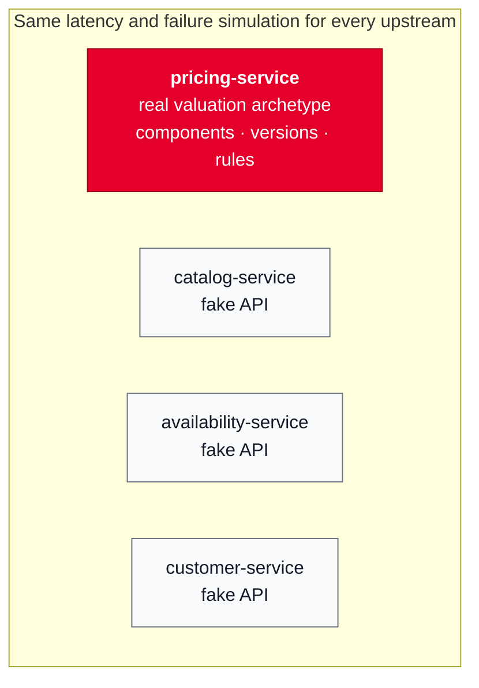

# Pricing as a real archetype implementation, other upstreams as mocks

## Context and Problem Statement

The four upstreams (Catalog, Pricing, Availability, Customer) run as separate services
(ADR 0002). We have to decide how much domain logic each of them gets, given the
assignment's 3–4 hour budget.

## Decision Drivers

* The author wants to demonstrate the Pricing archetype, its benefits and its flexibility.
* The budget is 3–4 hours. The assignment explicitly prefers a focused solution over a
  complete one.

## Considered Options

* Every service with full DDD and its matching archetype
* Every service as a lightweight mock
* Pricing as a real archetype implementation, the others as mocks

## Decision Outcome

Chosen option: "Pricing as a real archetype implementation, the others as mocks",
because it shows the archetype where it pays off most and stays within the budget.

### Consequences

* Good, because Pricing's flexibility can be shown live: promotions, discounts and new
  markets are introduced through configuration rather than code changes.
* Bad, because Pricing is the largest single item in the time budget. We implement only
  the part of the archetype the assignment needs.
* Neutral, because Pricing still has to behave like the upstream in the assignment
  (80 ms, 99.5%), so it gets the same latency and failure simulation as the mocks.
