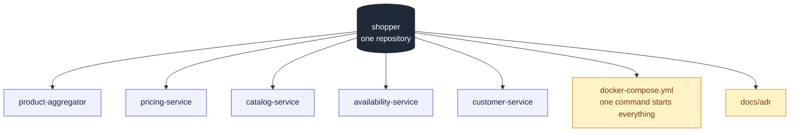

# Monorepo for all services

## Context and Problem Statement

The system consists of five services (ADR 0002): the aggregator and four upstreams.
We have to decide how their code is organised into repositories.

## Decision Drivers

* The system is small, delivered as one unit, and has to run locally with minimal
  setup.

## Considered Options

* One repository with a module per service
* A separate repository per service

## Decision Outcome

Chosen option: "One repository with a module per service", because the system is
reviewed, built and run as one unit.

### Consequences

* Good, because one clone and one command start the whole system.
* Neutral, because the choice fits the current size of the system and should be
  revisited as it grows.

## More Information

As the system grows the choice depends on complexity: a modular monolith is the likely
default, and for a very large system each service would get its own repository.
