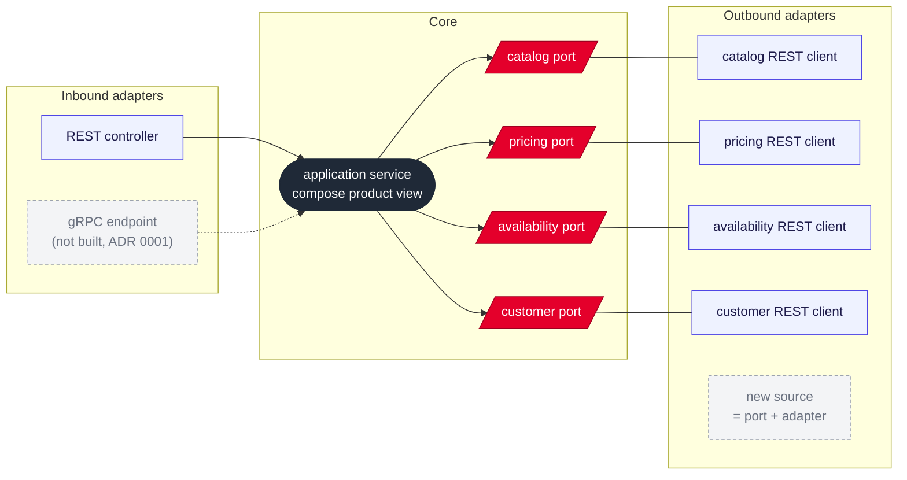

# Ports and adapters in the aggregator

## Context and Problem Statement

The aggregator is the core of the system: it receives requests over REST and calls
four upstreams. We have to decide how its code is structured internally. Upstream
mocks and Pricing are outside the scope of this decision.

## Decision Drivers

* New data sources must be addable without major refactoring.
* gRPC is out of scope (ADR 0001), but adding it later should not change the core.

## Considered Options

* Ports and adapters (hexagonal): a core with ports, an adapter per upstream and per
  inbound protocol
* Layered: controller → service → upstream clients

## Decision Outcome

Chosen option: "Ports and adapters", because inbound protocols and upstream sources
both become adapters around one application service. Adding gRPC means adding another
inbound adapter next to the REST controller, and adding a data source means adding a
port and its adapter, with no change to how the core handles calls and failures
(ADR 0017).

Packages follow the layers `domain`, `application` (inbound and outbound ports,
services), `infrastructure` (outbound adapters, configuration) and `presentation`
(inbound adapters such as REST).

### Consequences

* Good, because the core is tested without a network by substituting the ports.
* Bad, because there are more types and mapping than in a layered structure.
