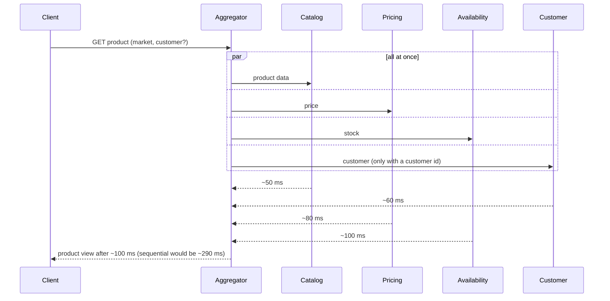

# Synchronous REST with parallel fan-out on the read path

## Context and Problem Statement

When a client asks for a product, the aggregator needs data from the upstreams (Catalog,
Pricing, Availability, Customer). We have to decide how the read path obtains it.

## Decision Drivers

* The client wants the product now, with current price and stock.
* The response time should stay reasonable even when upstreams are slow.
* A failing upstream must not break the whole response.

## Considered Options

* Synchronous REST calls to the upstreams, issued in parallel
* Reading everything from the aggregator's own projections, fed by upstream events
  (full CQRS)

## Decision Outcome

Chosen option: "Synchronous REST calls to the upstreams, issued in parallel", because
it returns current data, and calling in parallel keeps the response time close to the
slowest upstream (~100 ms) instead of their sum (~290 ms).

### Consequences

* Good, because upstream latency and failures reach the read path, where timeouts,
  circuit breakers and graceful degradation handle them.
* Bad, because the aggregator's availability depends on the upstreams, which is what
  those patterns have to compensate for.

## More Information

The read path follows the **Scatter-Gather** pattern from Enterprise Integration Patterns
(Hohpe & Woolf) in a simplified, in-process form: a fixed list of recipients is called in
parallel, and the replies are combined once all have arrived or the request budget
(ADR 0016) runs out. A full Scatter-Gather, with a Recipient List, an Aggregator that
correlates replies and an explicit completion strategy, built for example with Spring
Integration or Apache Camel, becomes worth it when recipients are reached over messaging
or change at run time.

Full CQRS was rejected because price and stock change too often for a lagging
projection, and because a broker with publishers and consumers is not justified by the
current requirements.
The slow-changing catalog is the exception, covered by ADR 0010.
