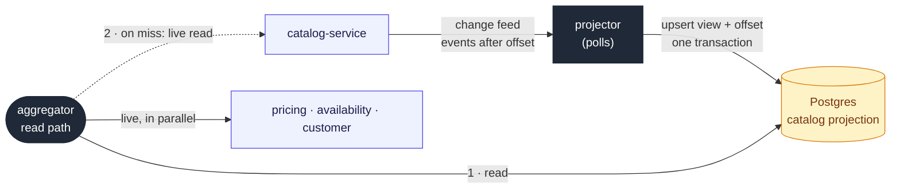

# Catalog projection in the aggregator fed by a change feed

## Context and Problem Statement

The aggregator should keep projections in Postgres. We have to decide what it projects
and how the projection is fed, given that the read path stays synchronous (ADR 0009).

## Decision Drivers

* Catalog data (name, description, specs, images) changes rarely; price and stock
  change constantly.
* Catalog is the only required upstream: its failure fails the request.
* The first version has limited time.

## Considered Options

* Full CQRS: every source projected through a message broker
* Last-known-good snapshot: successful responses stored and served only when an
  upstream fails
* No Postgres, in-memory cache only
* CQRS light: only the catalog projected, fed by a change feed the aggregator polls

## Decision Outcome

Chosen option: "CQRS light", because it applies projection only where data changes
slowly, and it takes the required upstream off the hot path. The catalog exposes an
ordered change feed; the aggregator polls it and stores the last processed offset with
the projection, which makes processing idempotent and replayable without a broker. On a
projection miss the aggregator reads the catalog live.

### Consequences

* Good, because a catalog outage no longer fails requests for products already
  projected.
* Bad, because it reinterprets the constraint "if Catalog fails, the request fails": it
  still holds for products not yet projected, and has to be agreed with the product
  owner.
* Bad, because it adds Postgres, migrations and a projector to the aggregator.

## More Information

Provisional: to be revisited while planning the details. If time gets tight, the
fallback is the last-known-good snapshot.
