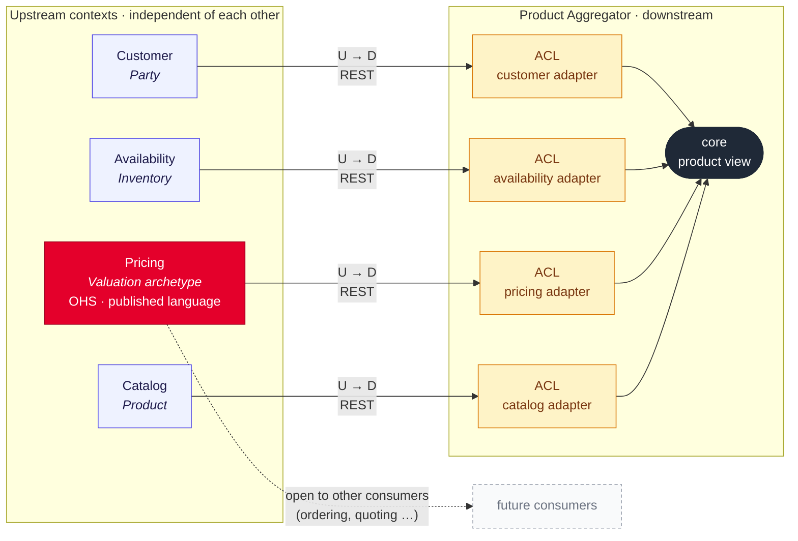

# Context map: upstreams behind anti-corruption layers, Pricing as open host service

## Context and Problem Statement

Five bounded contexts exist: the aggregator, Catalog, Pricing, Availability and Customer.
We have to decide how they relate: who is upstream, how the downstream adapts to the
upstream models, and whether upstreams depend on one another.

## Decision Drivers

* Changes in an upstream API should not spread into the aggregator's core (ADR 0008).
* The aggregator calls the upstreams in parallel (ADR 0009), which requires them to be
  independent of each other.
* Pricing provides a capability other consumers could use as well, not a process tied
  to the aggregator.

## Considered Options

* Upstreams behind anti-corruption layers in the aggregator; Pricing as an open host
  service; no dependencies between upstreams
* The aggregator conforms to the upstream models directly

## Decision Outcome

Chosen option: "Upstreams behind anti-corruption layers in the aggregator; Pricing as an
open host service; no dependencies between upstreams", because it keeps upstream changes
at the edge of the aggregator and keeps every upstream callable in parallel.

### Consequences

* Good, because an upstream API change ends at its adapter.
* Good, because no upstream waits for another, so a slow or failed upstream affects only
  its own section of the response.
* Bad, because every upstream needs a translation into the aggregator's model.
