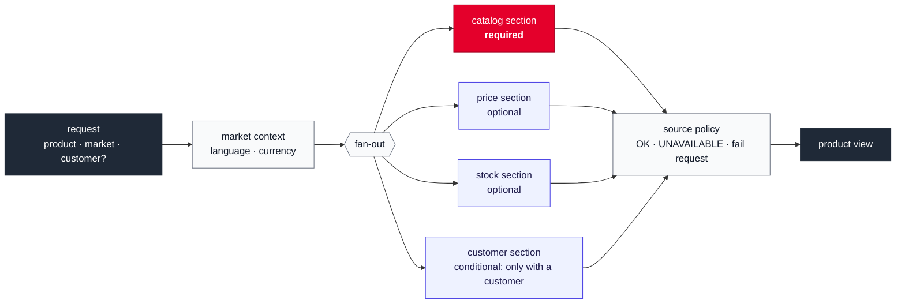

# Aggregator as an integration context without DDD aggregates

## Context and Problem Statement

The aggregator composes a product view from upstream data. It has no business rules of
its own to protect: it decides which sources are required, how each section degrades
and how the response fits the market. We have to decide how much domain modelling it
gets.

## Decision Drivers

* The aggregator is a simple service; its problem is integration and presentation, not
  business invariants.

## Considered Options

* An integration context: a plain model of sections, source policies and market context,
  without DDD aggregates
* Full tactical DDD: aggregates, domain events and repositories in the aggregator

## Decision Outcome

Chosen option: "An integration context without DDD aggregates", because there is no
state whose consistency the aggregator must guard, so aggregates would add structure
without protecting anything.

### Consequences

* Good, because the aggregator stays small and easy to follow.
* Good, because the contrast is deliberate: tactical DDD is applied in Pricing (ADR 0013),
  where real invariants exist.
