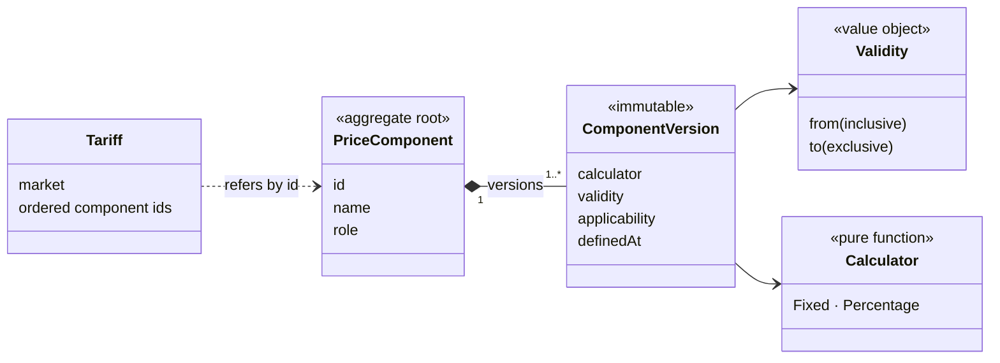

# PriceComponent as the aggregate in Pricing

## Context and Problem Statement

Pricing implements the valuation archetype (ADR 0003). Reading a price is a calculation
over configuration and changes nothing. Adding a new version of a price component (for
example a promotion) is a write that must keep the component's versions unambiguous.
We have to decide where the consistency boundary lies.

## Decision Drivers

* An aggregate belongs where a write must uphold an invariant, and nowhere else.
* Per the archetype, a component keeps a stable identity while its configuration is
  versioned, and composite components refer to their parts by id.

## Considered Options

* `PriceComponent` as the aggregate: the component with its immutable versions
* No aggregates: Pricing as calculations over plain data

## Decision Outcome

Chosen option: "`PriceComponent` as the aggregate", because adding a version is the one
write in Pricing with invariants to protect:

* at any point in time at most one version applies; when several match, the one that
  started last wins;
* a version identical to an existing one is rejected;
* a validity period is half-open and its start precedes its end.

A write appends a version; it never edits one: the component is read, the new version
is added and the component is saved. The read path, calculators, `Money`, `Validity`
and the price breakdown are not aggregates. The composite is a `Tariff`: the ordered
ids of the components that make up a market's price, unversioned.

### Consequences

* Good, because the invariants live in one place.
* Good, because components referring to each other by id means a change to one
  component applies in every price that uses it, without rewiring.
* Neutral, because a customer discount contract is a second aggregate candidate (one
  applicable contract per customer per period); it is in scope only if time allows.

## More Information

Concurrent writers are not handled: the service has a single operator, who appends
versions by hand. With several writers, two saves of the same component could overwrite
each other (a lost update). The fix then is optimistic locking: a version number on the
component, returned as an `ETag`, `If-Match` required on the write, and `409` or `412`
on a mismatch (with JPA: `@Version`).
