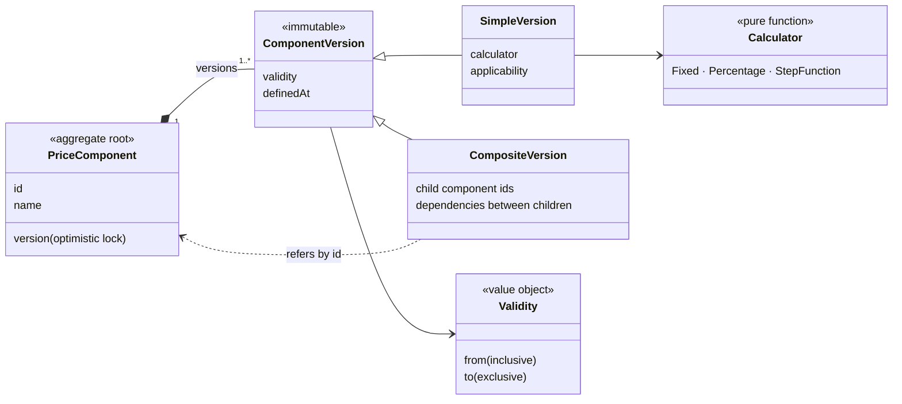
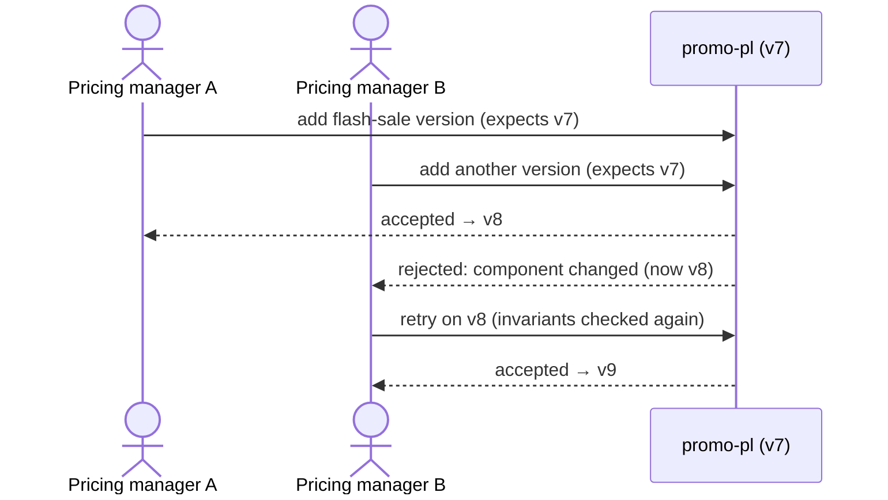

# PriceComponent as the aggregate in Pricing

## Context and Problem Statement

Pricing implements the valuation archetype (ADR 0003). Reading a price is a calculation
over configuration and changes nothing. Adding a new version of a price component (for
example a promotion) is a write that must keep the component's versions unambiguous,
and two people may do it at the same time. We have to decide where the consistency
boundary lies.

## Decision Drivers

* An aggregate belongs where a write must uphold an invariant under concurrent changes,
  and nowhere else.
* Per the archetype, a component keeps a stable identity while its configuration is
  versioned, and composite components refer to their parts by id.

## Considered Options

* `PriceComponent` as the aggregate: the component with its immutable versions
* No aggregates: Pricing as calculations over plain data

## Decision Outcome

Chosen option: "`PriceComponent` as the aggregate", because adding a version is the one
write in Pricing with invariants to protect:

* at any point in time exactly one version applies; when validity periods overlap, the
  version with the later start wins;
* a version identical to the current one is rejected;
* a validity period is half-open and its start precedes its end.

Concurrent changes to the same component are resolved with optimistic locking: the
second write is rejected and has to be retried. The read path, calculators, `Money`,
`Validity` and the price breakdown are not aggregates.

### Consequences

* Good, because the invariants live in one place and concurrent edits cannot leave a
  component ambiguous.
* Good, because components referring to each other by id means a change to one
  component applies in every price that uses it, without rewiring.
* Neutral, because a customer discount contract is a second aggregate candidate (one
  applicable contract per customer per period); it is in scope only if time allows.
