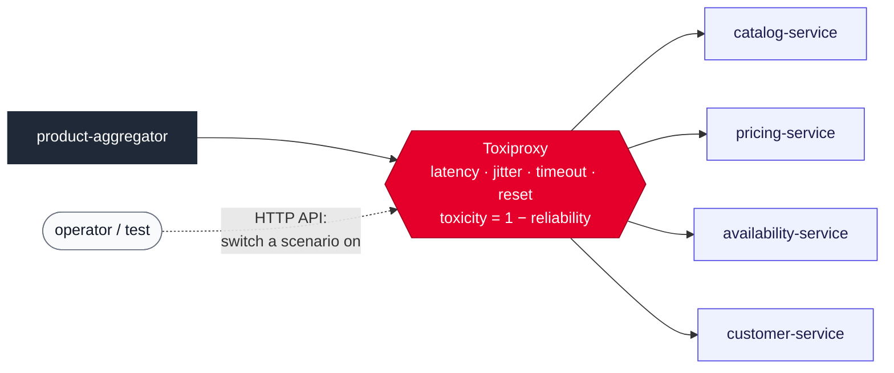

# Toxiproxy for simulating upstream latency and failures

## Context and Problem Statement

The simulated upstreams have to behave realistically: artificial delays and
occasional failures matching each service's typical latency and reliability. We have to
decide where that behaviour is simulated.

## Decision Drivers

* The simulation should reproduce how failures happen in a distributed system, so that
  the aggregator's resilience is exercised against realistic faults.
* Failure scenarios ("Pricing starts timing out") should be switchable live.

## Considered Options

* Toxiproxy: a proxy container between the aggregator and each upstream
* A simulation filter inside every upstream service
* `tc netem` network emulation inside the containers

## Decision Outcome

Chosen option: "Toxiproxy", because it injects faults where they really happen, in the
network between services, so the mocks stay plain and the aggregator meets real
timeouts, resets and slow connections. Its HTTP API switches scenarios on at run time.

### Consequences

* Good, because the mocks contain no simulation code.
* Bad, because Toxiproxy produces network faults only, not HTTP 5xx responses; a mock
  can return one directly if a 5xx case is needed.
* Neutral, because toxicity applies per connection, and the HTTP client reuses
  connections, so failures arrive in bursts rather than independently. Real outages
  behave that way too, and bursts are what open a circuit breaker.

## More Information

`tc netem` was rejected because packet loss shows up as TCP retransmissions rather than
clear, observable failures.
