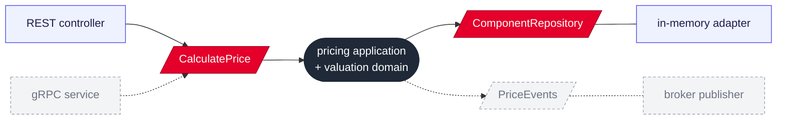

# Ports and adapters in Pricing, with gRPC and broker as future adapters

## Context and Problem Statement

ADR 0008 applies ports and adapters to the aggregator. Pricing, the only upstream with a
real domain model (ADR 0003), needs an internal structure too. Communication is
synchronous REST today (ADR 0009), but a message broker may join later.

## Decision Drivers

* The same structure in both services, so gRPC and a broker are explained once.
* Adding gRPC or a broker later should be an adapter, not a change to the domain.
* Only what is used gets built.

## Considered Options

* Ports and adapters, with gRPC and the broker shown as future adapters but not built
* Ports and adapters, with gRPC and broker adapters built now
* Layered: controller → service → repository

## Decision Outcome

Chosen option: "Ports and adapters, with gRPC and the broker shown as future adapters
but not built", because it keeps today's scope to REST while leaving a clear place for
each future transport: gRPC as an inbound adapter next to the REST controller, a broker
as an outbound publisher in Pricing and an inbound listener in the aggregator. Adapters
talk to adapters; the domain stays unaware of the transport.

Packages follow the same layers as the aggregator (ADR 0008). The repository of the
`PriceComponent` aggregate is declared in `domain`, because it stores the domain's own
aggregate; outbound ports are reserved for other systems.

### Consequences

* Good, because adding gRPC or a broker later means adding an adapter in a known place
  rather than refactoring.
* Neutral, because the future adapters exist only in diagrams and the README; no empty
  packages or unused interfaces are created.

## More Information

Domain events are not built yet, because nothing consumes them. The intended path once a
broker exists: a private domain event inside Pricing (e.g. a component version added) is
translated at the service boundary into a public integration event, published through
the broker adapter, and consumed by a listener adapter in the aggregator, which can
evict a cached price or maintain a projection. The same mechanism would feed a catalog
projection (rejected for now in ADR 0010). A precomputed read model of current prices is
not on this path: prices depend on validity periods, and the passing of a period boundary
produces no event, so such a projection would go stale without a scheduler.
