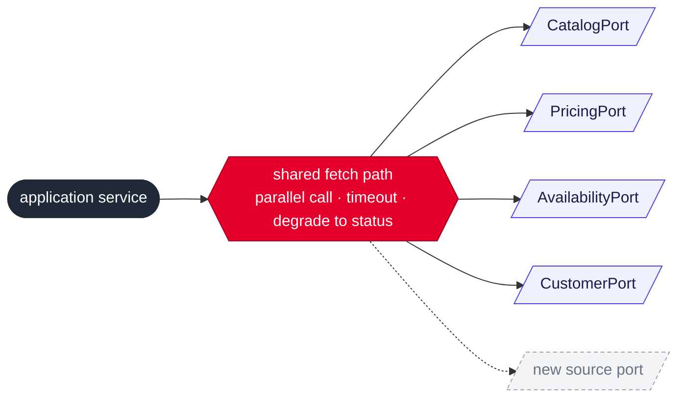

# Typed ports with one shared fetch path for upstream sources

## Context and Problem Statement

The aggregator composes one response from several upstreams (Scatter-Gather in
Enterprise Integration Patterns, API Composition in microservice terms). New upstreams
will join over time, for example a related-products service. We have to decide how a
source plugs into the aggregator so that adding one stays simple.

## Decision Drivers

* Adding a source should not require new logic for parallel calls, timeouts or
  degradation.
* The code should stay simple and readable at the current number of sources (four).

## Considered Options

* Typed ports, each source going through one shared fetch path in the application
  service
* A generic source contract (name, policy, timeout, fetch) with sources discovered as a
  list, and the response built as a map of sections

## Decision Outcome

Chosen option: "Typed ports with one shared fetch path", because every source gets the
same parallel call, timeout and degradation from one place, while the response keeps a
typed shape. Adding a source means a port, its adapter, one line in the application
service and a new optional section in the response.

### Consequences

* Good, because resilience behaviour is written once and applies to every source.
* Good, because a new source is an additive change for clients: a new optional section
  with a status, which existing clients ignore.
* Bad, because each new source still touches the application service and the response
  type.

## More Information

The generic source contract becomes worth it when the number of sources grows well
beyond the current four.
