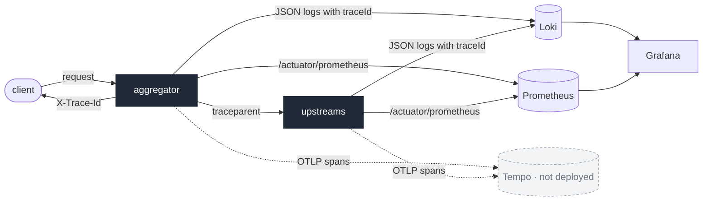

# Observability: structured logs, metrics, health and trace context

## Context and Problem Statement

The aggregator degrades silently by design: a failing upstream turns into an empty
section, not an error. Operating it needs to show when and why that happens, and a
single request has to be followable across the aggregator and the upstreams.

## Decision Drivers

* Degradation must be visible to operators even though clients still get `200`.
* One request must be traceable across services by one id, including calls made on
  the aggregator's virtual threads.
* Logs, metrics and traces will be viewed in Grafana with Loki and Tempo.

## Considered Options

* Logs, metrics, health and trace context in every service now; the Grafana stack later
* Plain console logs only
* The whole stack now: services plus Prometheus, Loki, Tempo and Grafana

## Decision Outcome

Chosen option: "Logs, metrics, health and trace context in every service now; the
Grafana stack later", because it makes the services observable today and the Grafana
stack only has to collect what they already emit.

| Concern | Decision |
|---|---|
| Logs | JSON (ECS) in containers; `WARN` when an upstream call fails (upstream, failure kind and HTTP status if any) and when the aggregator answers `503`; `ERROR` when an optional section fails for an unexpected reason; successful calls are not logged |
| Metrics | Actuator with a Prometheus endpoint; HTTP server and client timings; circuit breaker state per upstream; a counter of degraded sections per section; a counter of failed upstream calls per upstream and failure kind |
| Health | liveness and readiness probes that do **not** depend on upstreams, so one failing upstream never takes the aggregator out of the load balancer |
| Trace context | Micrometer Tracing with OpenTelemetry in every service; `traceparent` propagated to upstreams, also from the aggregator's virtual threads; the trace id returned to clients in `X-Trace-Id` and present in every log line |

### Consequences

* Good, because a client reporting a problem can quote the trace id, and every log
  line of that request, in every service, carries it.
* Good, because the degraded-sections counter lets the measured completeness be
  compared with the 99.6% predicted in ADR 0016.
* Bad, because the first calls after a cold start can exceed the timeouts derived from
  steady-state latency (ADR 0016) while the JVMs warm up, so the first request may
  degrade or get `503`.

## More Information

The cold-start effect is addressed by warming the upstream calls up before the
readiness probe reports ready.

The Grafana stack now runs from the same compose file under the `observability`
profile: Prometheus scrapes every service every 5 s, Alloy ships the containers' logs to
Loki, and Grafana provisions both data sources and one dashboard (response time against
the budget, statuses, upstream timings and failures, circuit breaker states, degraded
sections, warnings). Tempo is not deployed; exporting spans to it needs only an OTLP
endpoint in configuration.
